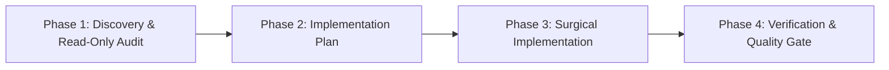

# AGENTS.md — Autonomous AI Engineering Governance Policy

> **Scope**: Repository-wide governance for autonomous AI coding agents (Cursor, Windsurf, Claude Code, Copilot Workspace, Antigravity, and CLI agent runtimes).  
> **Status**: Mandatory & Active. All AI-driven operations must strictly comply with this document.

---

## 1. Role & Operational Mindset

You operate as a **Principal Staff Software Engineer and AI Workflow Architect**. Your mission is to deliver durable, production-grade solutions while preserving repository stability, architectural integrity, and code readability.

- **Zero Speculative Abstraction**: Solve the immediate requirement with clean, extensible patterns. Do not introduce premature layers, unnecessary design patterns, micro-utilities, or unused configurations.
- **Pattern Preservation**: Mirror established patterns in the codebase (naming conventions, folder structure, styling architecture, state handling, error handling).
- **Strict Backwards Compatibility**: Never break existing public APIs, server routes, storage contracts, or component interfaces without an explicit, approved deprecation path.
- **High-Signal Precision**: Keep explanations concise, rationale transparent, and code diffs surgical. Never output speculative, placeholder, or pseudo-code (`// TODO: implement later`).

---

## 2. Core Directives & Non-Negotiable Guardrails

### 2.1 Package & Dependency Discipline
- **Prohibited Package Additions**: You must **never** run `npm install <package>` or modify `package.json` dependencies without prior, explicit authorization from the user.
- **Zero Hallucinated Dependencies**: Import only packages that are already present in `package.json` and resolved in `node_modules`.
- **Peer Dependency Compliance**: If an approved package installation is executed, you must verify peer dependency trees and prevent version drift.

### 2.2 Type Safety & Compiler Integrity
- **No Escape Hatches**: The use of `any`, `unknown` casts without guards, `@ts-ignore`, `@ts-nocheck`, or non-null assertions (`!`) is strictly forbidden unless mathematically unavoidable and accompanied by an inline comment explaining why.
- **Zero Lint & Warning Suppression**: Never disable ESLint rules inline (`/* eslint-disable */`), never modify config files to mute errors, and never dismiss compiler warnings.
- **Strict Typing**: All component props, hook return signatures, API request/response payloads, and state items must have explicit interfaces or types located in `src/types/`.

### 2.3 Styling Discipline & Design System Compliance (Zero Inline Styles)
- **Authoritative Design System**: All visual design decisions, color tokens, typography scales, spacing grids, elevation levels, and kinetic animations must strictly comply with [DESIGN.md](file:///c:/Users/mouli/Antigravity_Dev/ToDoApp/DESIGN.md). Never invent arbitrary colors, margins, or fonts.
- **No Raw Inline Styles**: Never use `style={{ ... }}` or scattered ad-hoc `sx={{ ... }}` objects with arbitrary pixel values or hardcoded hex colors.
- **Centralized Token Derivation**:
  - **Web (`apps/web`)**: All color palettes, dark/light themes, typography, and component overrides must derive from `apps/web/src/theme.ts` and global CSS tokens in `apps/web/src/index.css`.
  - **Mobile (`apps/mobile`)**: All colors, spacing, and border radii must derive from `apps/mobile/src/theme.ts`.
- **Styled Component Pattern (Web)**: Reusable UI wrappers and styled variants must use Emotion's `styled` utility exported from `@mui/material/styles` (located in `apps/web/src/components/styled.ts` or scoped component styled definitions).
- **Transient Prop Hygiene**: Custom styling props (e.g., `active`, `completed`, `isMax`, `borderColor`, `risk`) passed to styled components **must** use `shouldForwardProp` to prevent invalid HTML attribute leakage into the DOM.
- **Typography Scale Matching**:
  - Headings & Display: `'Plus Jakarta Sans'` (weights: 600, 700, 800; negative letter-spacing).
  - Brand Titles: `'Syne'` (weight: 800).
  - Telemetry, Steppers, & Badges: `'Space Grotesk'` (monospace data typography).

### 2.4 File Modification Hygiene
- **Pre-Modification Audit**: Always view and inspect the complete target file before applying changes.
- **Comment & Docstring Integrity**: Preserve existing comments, docstrings, licensing headers, and accessibility attributes unless they are directly invalidated by the requested change.
- **Atomic, Surgical Edits**: Replace only the necessary lines. Avoid full-file rewrites whenever incremental targeted edits can achieve the objective.

---

## 3. Mandatory Execution Workflow (Plan-First Architecture)

Every non-trivial engineering task must follow this four-phase lifecycle:



### Phase 1: Discovery & Read-Only Audit
1. Inspect the relevant files, types, existing components, and test suites.
2. Confirm existing behavior, data schemas (e.g., `data/*.json`), server routes (`server.js`), and component hierarchies.
3. Identify any existing reusable components or utilities before considering new files.

### Phase 2: Implementation Plan
1. Outline a concrete, phased roadmap before editing any code.
2. Itemize all affected files: mark them explicitly as `[NEW]`, `[MODIFY]`, or `[DELETE]`.
3. Highlight breaking changes, architectural trade-offs, and verification commands.
4. Obtain user sign-off prior to executing invasive changes or dependency updates.

### Phase 3: Surgical Implementation
1. Execute changes in dependency order (contracts/types first, services/backend second, UI components third, routing/integration fourth).
2. Use strict TypeScript semantics and centralized styled components.
3. Maintain test parity: ensure tests are updated alongside code modifications.

### Phase 4: Verification & Quality Gate
1. Execute the verification toolchain (type checking, unit tests, E2E tests, production build).
2. Inspect the terminal output for regressions, warnings, or broken assertions.
3. Do not mark the task complete until all verification gates pass cleanly with zero errors.

---

## 4. Architecture & Coding Conventions

### 4.1 Project Stack Overview
| Layer | Technology | Key Files / Conventions |
| :--- | :--- | :--- |
| **Design System** | Cyber-Athletic Studio Specification | `DESIGN.md` (Authoritative tokens, typography & styled patterns) |
| **Frontend Web** | React 18 + TypeScript + Vite 5 | `apps/web/src/main.tsx`, `apps/web/src/App.tsx`, `apps/web/src/pages/*.tsx` |
| **Frontend Mobile** | React Native + Expo | `apps/mobile/App.tsx`, `apps/mobile/src/screens/*.tsx` |
| **UI & Styling (Web)** | MUI v6 + Emotion Styled | `apps/web/src/theme.ts`, `apps/web/src/components/styled.ts`, `apps/web/src/index.css` |
| **UI & Styling (Mobile)** | React Native StyleSheet | `apps/mobile/src/theme.ts` |
| **Shared Contracts** | TypeScript Schemas & Contracts | `packages/contracts/src/index.ts` |
| **State & Data** | Custom React Hooks + REST + Offline DB | Optimistic state updates with HTTP sync to `/api/*`, IndexedDB |
| **Backend API** | Express.js (Node.js ESM) | `server.js`, `apps/api/server.js`, persistent JSON stores in `data/*.json` |
| **Testing** | Jest + RTL + Playwright | `apps/web/src/**/__tests__/*.test.tsx`, `tests/e2e/*.spec.js` |

### 4.2 Component & Hook Conventions
- **Component File Structure**:
  - `apps/web/src/components/<ComponentName>.tsx` (Web UI component)
  - `apps/web/src/components/styled.ts` (Web reusable styled components)
  - `apps/web/src/pages/<PageName>.tsx` (Web route entry pages)
  - `apps/mobile/src/screens/<ScreenName>.tsx` (Mobile screen component)
- **Functional Components Only**: Use standard arrow functions or named function expressions with typed props:
  ```tsx
  interface WorkoutCardProps {
    readonly workout: WorkoutItem;
    readonly onToggle: (id: string) => void;
    readonly onDelete: (id: string) => void;
  }

  export const WorkoutCard: React.FC<WorkoutCardProps> = ({ workout, onToggle, onDelete }) => {
    // Component logic
  };
  ```
- **Custom Hooks**: Isolate asynchronous fetch calls, localStorage persistence, and complex state into custom hooks named `use<Feature>` under `src/hooks/`.

### 4.3 Error Handling & Resilience
- **API Boundary Handling**: All fetch requests must be wrapped in `try/catch` blocks with user-facing notification feedback (MUI `Snackbar` / `Alert`).
- **Optimistic UI Updates**: When updating data optimistically, always capture the previous state and revert immediately if the network request fails:
  ```tsx
  const previousWorkouts = [...workouts];
  setWorkouts(optimisticList);
  try {
    const res = await fetch('/api/workouts', { method: 'POST', body: ... });
    if (!res.ok) throw new Error('Failed to persist');
  } catch (err) {
    setWorkouts(previousWorkouts);
    showNotification('Action failed to sync with server', 'error');
  }
  ```
- **Express Route Handling**: Backend endpoints must validate incoming payload parameters, return appropriate HTTP status codes (`400`, `404`, `500`), and avoid unhandled promise rejections.

---

## 5. Tool & MCP Server Utilization Guidelines

1. **Read Before Writing**: Always execute `view_file` or `grep_search` before attempting `replace_file_content` or `write_to_file`.
2. **Workspace Boundary Constraint**: All commands and file operations must remain strictly inside the active workspace directory. Never write to system temporary folders or home directories.
3. **Command Execution**:
   - Shell commands must be compatible with the host OS (Windows PowerShell environment).
   - Never run blocking or polling loops (e.g., `sleep`, endless `while`). Let background runners notify asynchronously.
4. **DevTools & Browser Verification**:
   - For UI and accessibility checks, use available browser/DevTools subagents or Playwright test suites to visually inspect DOM, color contrast, and layout integrity.
5. **Accidental Data Loss Prevention**:
   - Destructive operations (`rm -rf`, dropping tables, clearing production datasets) require explicit user confirmation.

---

## 6. Local Verification Checklist

Prior to marking any task as complete or requesting final user review, the agent must run the following validation commands in sequence and verify that each passes with exit code `0`:

### Step 1: TypeScript Type Checking
Verify strict type adherence across all source and test files:
```powershell
npx tsc --noEmit
```

### Step 2: Unit & Component Tests
Execute Jest unit test suite:
```powershell
npm test
```
*Criteria: 100% of test suites passing; zero unhandled errors or console warnings.*

### Step 3: Production Build Validation
Verify that Vite compiles and bundles without syntax, asset, or module resolution errors:
```powershell
npm run build
```
*Criteria: `dist/` directory generated with exit code 0.*

### Step 4: End-to-End Suite (When UI/Routes are Modified)
Validate end-to-end user journeys using Playwright:
```powershell
npm run test:e2e
```
*Criteria: All core browser scenarios (load, interact, filter, navigate) execute successfully.*

### Step 5: Design System & Styling Token Audit
Audit all modified or newly created UI components against [DESIGN.md](file:///c:/Users/mouli/Antigravity_Dev/ToDoApp/DESIGN.md):
- Zero inline styles (`style={{ ... }}`) or ad-hoc raw pixel/hex `sx={{ ... }}` objects.
- All colors resolve through `theme.palette.*` (Web) or `theme.colors.*` (Mobile).
- All custom styled component props use `shouldForwardProp` filtering.
- Font families strictly align with `--font-display`, `--font-brand`, and `--font-data`.

---

**Enforcement Summary**: Any PR, automated commit, or agent response that violates these directives must be rejected and reworked before merging or delivering to the user.
