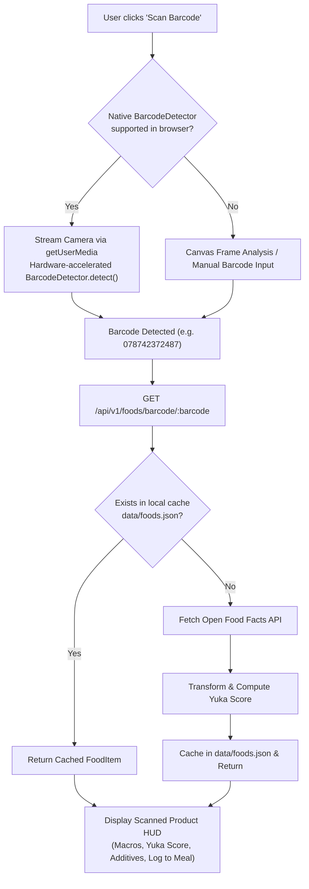

# Architectural Plan: Food Intel Barcode Scanning & Open Source Database Integration

> **Target**: Add real-time barcode scanning (UPC/EAN) to Food Intel, backed by the global open-source **Open Food Facts** database, client-side camera detection, and Yuka-style quality scoring.  
> **Status**: Proposed for Review & Sign-Off.

---

## 1. Open Source Food Barcode Data: Evaluation & Strategy

### 1.1 Why Open Food Facts (OFF)?
The premier open-source food database globally is **[Open Food Facts](https://world.openfoodfacts.org/)**:
* **Database Scale**: 3.5+ million verified food products worldwide with universal barcodes (UPC-A, EAN-13, EAN-8).
* **Open Governance**: Non-profit, collaborative database distributed under the Open Database License (ODbL).
* **Zero API Key Friction**: Free REST API without paid tiers or rate limit barriers for typical application usage:
  ```http
  GET https://world.openfoodfacts.org/api/v2/product/{barcode}.json
  User-Agent: IronPulseWorkoutTracker/1.0 (contact@ironpulse.fit)
  ```
* **Rich Nutritional & Health Telemetry**:
  | Telemetry Field | Open Food Facts Path | IronPulse Mapping |
  | :--- | :--- | :--- |
  | **Identity & Brand** | `product.product_name`, `product.brands` | `name`, `brand` |
  | **Serving & Portion** | `product.serving_size` | `servingSize` |
  | **Macronutrients** | `product.nutriments.energy-kcal_100g`, `proteins_100g`, `carbohydrates_100g`, `fat_100g` | `calories`, `protein`, `carbs`, `fat` |
  | **Nutri-Score** | `product.nutriscore_grade`, `product.nutriscore_score` | 60% of Yuka calculation |
  | **Nova Processing Group** | `product.nova_group` (1 = unprocessed to 4 = ultra-processed) | `novaGroup` (1 - 4) |
  | **Food Additives** | `product.additives_tags` (e.g. `en:e250`, `en:e150d`) | Parsed against additive hazard index |
  | **Organic Certification**| `product.labels_tags` (contains `en:organic`) | `isOrganic: boolean` (+10 pts bonus) |
  | **Packaging Image** | `product.image_front_small_url` / `image_url` | `imageUrl?: string` |

### 1.2 Yuka Scoring Algorithm
Open Food Facts data will be fed into a deterministic 100-point algorithm:
$$Score = (NutriScore \times 0.60) + (AdditiveHazard \times 0.30) + (OrganicBonus \times 0.10)$$
* **Nutri-Score (60%)**: Grade A (100), B (80), C (60), D (40), E (20).
* **Additives (30%)**: 100 base score minus penalties based on toxicity (Hazardous: -30, Moderate: -15, Low: -5).
* **Organic Bonus (10%)**: +10 points if certified organic.
* **Rating**: Excellent ($\ge 75$), Good ($50 - 74$), Mediocre ($25 - 49$), Bad ($< 25$).

---

## 2. Hardware & Camera Barcode Scanning Architecture



### 2.1 Native Browser `BarcodeDetector` (Zero-Dependency)
- Standard W3C / Chromium API:
  ```typescript
  const detector = new (window as any).BarcodeDetector({
    formats: ['ean_13', 'upc_a', 'upc_e', 'ean_8', 'qr_code'],
  });
  const barcodes = await detector.detect(videoRef.current);
  ```
- **Fallback**:
  - Manual numeric UPC/EAN keypad with quick test sample chips for desktop environments without a camera.
  - Image file upload scan (user takes a photo of the barcode).

---

## 3. Backend Proxy & Offline-Resilient Caching (`server.js`)

To prevent CORS issues, avoid client rate-limiting, and ensure offline resilience:
1. **Endpoint**: `GET /api/v1/foods/barcode/:code`
2. **Lookup Flow**:
   - Check `data/foods.json` first (`food.barcode === code`).
   - If miss, request `https://world.openfoodfacts.org/api/v2/product/${code}.json`.
   - Normalize product into `FoodItem`.
   - Append to `data/foods.json` and persist so subsequent scans work offline without internet.

---

## 4. Itemized Implementation Roadmap

| File | Change Type | Purpose |
| :--- | :---: | :--- |
| `packages/contracts/src/index.ts` | `[MODIFY]` | Add `BarcodeLookupResponseSchema` and `barcode` field to food contracts |
| `apps/web/src/types/nutrition.ts` | `[MODIFY]` | Add `barcode?: string` and `imageUrl?: string` to `FoodItem` |
| `server.js` | `[MODIFY]` | Implement `GET /api/v1/foods/barcode/:code` with Open Food Facts integration |
| `apps/web/src/components/BarcodeScannerModal.tsx` | `[NEW]` | Camera viewfinder, reticle HUD, native barcode detector loop, and sample test barcodes |
| `apps/web/src/pages/FoodScannerPage.tsx` | `[MODIFY]` | Add "📷 SCAN BARCODE" button and wire scanner result into inspector card and meal logger |
| `apps/web/src/components/__tests__/BarcodeScannerModal.test.tsx` | `[NEW]` | Unit tests for scanner modal, barcode validation, and manual input fallback |
| `tests/e2e/gym-tracker.spec.js` | `[MODIFY]` | Add Playwright E2E journey for barcode scanning and food inspection |

---

## 5. Verification Commands & Quality Gates

Following our mandatory verification checklist:
1. `npm run typecheck` (Turborepo type checks across all 4 packages)
2. `npm test` (Jest unit test suite)
3. `npm run build` (Vite production bundle validation)
4. `npm run test:e2e` (Playwright E2E user journeys)
