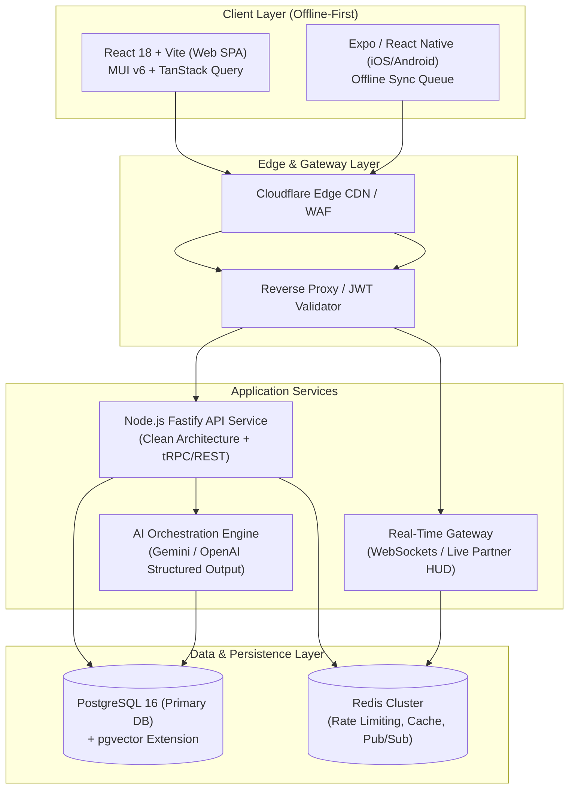
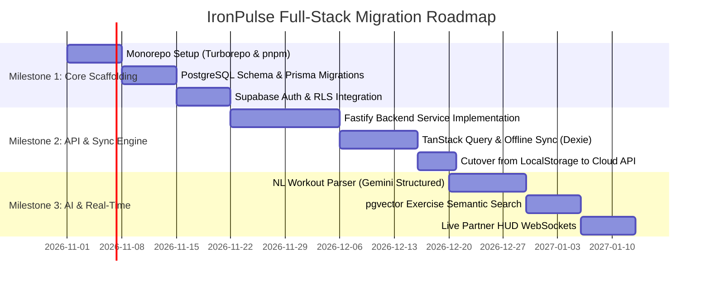

# IronPulse: Enterprise Full-Stack Architectural Blueprint & Scaling Strategy

> **Author**: Principal Software Architect  
> **Target Application**: IronPulse Gym & Nutrition Tracker  
> **Repository Baseline**: React 18, Vite 5, MUI v6, Express.js (`server.js`), React Native (`mobile/`)  
> **Status**: Approved Architectural Blueprint  

---

## Executive Summary

IronPulse is transitioning from a client-side static application hosted on GitHub Pages (`https://jsesetty.github.io/WorkoutTracker/`) into an enterprise-grade, offline-first, full-stack fitness and nutrition platform with cross-platform clients (Web & Mobile), multi-tenant security, and an AI-driven workout engine.

This document provides the complete architectural blueprint across all six engineering modules.



---

## Module 1: Codebase Audit & Decoupling

### 1. Current State Management Audit
- **Architecture**: The application relies on monolithic root-level `useState` hooks inside [src/App.tsx](file:///c:/Users/mouli/Antigravity_Dev/ToDoApp/src/App.tsx) (`workouts`, `snackbar`, `mode`, `filter`). State is prop-drilled down through components (`WorkoutList`, `WorkoutItem`, `WorkoutMeter`, `NutritionPage`).
- **Coupling**: State is tightly coupled to browser `localStorage` and synchronous JSON arrays via [src/services/storageFallback.ts](file:///c:/Users/mouli/Antigravity_Dev/ToDoApp/src/services/storageFallback.ts). Mutation handlers execute ad-hoc optimistic updates, catch fetch errors, and manually sync to `storage.saveWorkouts()`.
- **Target Architecture**:
  1. **Server State**: Decouple all data queries and mutations into **TanStack Query (React Query v5)**. Handles caching, background refetching, deduping, and out-of-the-box optimistic updates with rollback.
  2. **Client UI State**: Extract ephemeral interface state (drawer visibility, active session timer, quick filter tabs, modal forms) into a **Zustand** store.

### 2. Model Extraction & Full-Stack Contracts
The existing models in [src/types/workout.ts](file:///c:/Users/mouli/Antigravity_Dev/ToDoApp/src/types/workout.ts) and [src/types/nutrition.ts](file:///c:/Users/mouli/Antigravity_Dev/ToDoApp/src/types/nutrition.ts) are flat UI representations without validation.
- **Contract Strategy**: Transition from static TS interfaces to **Zod schemas**. Zod schemas generate both:
  - Runtime validation schemas on the server (request payload validation).
  - Static TypeScript types on the client (`z.infer<typeof WorkoutSchema>`).
- **Separation of Concerns**:
  - `Entity`: Database representation with relational keys (`workoutSessionId`, `userId`, `auditTimestamps`).
  - `DTO (Data Transfer Object)`: Network payloads (`CreateWorkoutSessionDTO`, `LogSetDTO`).
  - `ViewModel`: Client presentation state (e.g., set formatted for UI badges, 1RM estimations).

### 3. Repository Topology
**Recommendation: Monorepo with Turborepo and pnpm Workspaces**.
```text
ironpulse/
├── apps/
│   ├── web/               # React 18 + Vite (Current Web App)
│   ├── mobile/            # Expo / React Native App
│   └── api/               # Fastify / Node.js Backend Microservice
├── packages/
│   ├── contracts/         # Zod schemas, DTOs, API endpoints
│   ├── db/                # Prisma / Drizzle Schema & Migrations
│   ├── ui/                # Shared theme tokens & UI utilities
│   └── tsconfig/          # Shared compiler configurations
├── package.json
├── pnpm-workspace.yaml
└── turbo.json
```
- **Trade-off Analysis**:
  - *Monorepo*: Single source of truth, zero-drift contract sharing between Web, Mobile, and API, unified CI/CD quality gates.
  - *Multi-repo*: Independent deploy cadences, but causes high contract synchronization friction and version drift.

---

## Module 2: Authentication, Identity & Session Architecture

### 4. Auth Provider Evaluation
| Solution | Pros | Cons | Recommendation |
| :--- | :--- | :--- | :---: |
| **Supabase Auth (GoTrue)** | Native PostgreSQL RLS integration, free tier, social auth, zero cost marginal compute | Vendor tied to PostgreSQL | **Winner (Best with Postgres)** |
| **Clerk** | World-class drop-in UI, multi-session, user management, native React hooks | Expensive past 10k MAU, separate from DB RLS | High-velocity alternative |
| **Self-Hosted JWT (Argon2 + Redis)** | 100% data ownership, zero vendor lock-in | Security maintenance, session revocation complexity | Overkill for Phase 1 |

**Architectural Decision**: **Supabase Auth** or **Clerk** with JWT verification on the API gateway. When paired with PostgreSQL, Supabase Auth embeds `auth.uid()` directly into database connection contexts, enforcing security at the database engine level.

### 5. Session & Auth State Propagation
1. **Token Transport**: Access tokens stored in memory (short-lived, 15m), Refresh tokens issued in `httpOnly`, `Secure`, `SameSite=Strict` cookies.
2. **Client Integration**:
   - Custom `useAuth` hook powered by Zustand.
   - Axios / Fetch client interceptor automatically attaches `Authorization: Bearer <accessToken>` and handles `401 Unauthorized` by triggering silent refresh flow.
   - React Router `<ProtectedRoute>` boundary wraps `/history`, `/analytics`, `/nutrition`.
3. **Cache Synchronization**: On logout, TanStack Query executes `queryClient.clear()` to purge all cached user data from memory and storage.

### 6. Multi-Tenancy & Authorization Modeling
Implement **Hybrid RBAC + ReBAC (Relationship-Based Access Control)**:
- **Roles**: `Athlete`, `Coach`, `Admin`.
- **Tenancy Boundary**: Every session and exercise belongs to a `userId`.
- **Relationship Sharing**:
  ```text
  UserRelationship (id, coachId, athleteId, permissionLevel: 'READ' | 'WRITE')
  ```
- **PostgreSQL Row Level Security (RLS)**:
  ```sql
  CREATE POLICY "Users can access their own workouts"
  ON workout_sessions FOR ALL
  TO authenticated
  USING (
    user_id = auth.uid() 
    OR EXISTS (
      SELECT 1 FROM user_relationships 
      WHERE coach_id = auth.uid() 
        AND athlete_id = workout_sessions.user_id
    )
  );
  ```

---

## Module 3: Database Selection & Schema Design

### 7. Database Engine Selection: Relational (PostgreSQL) vs. Document
**Architectural Decision: PostgreSQL 16**.
- **Rationale**: While a single workout appears hierarchical (`Session -> Exercise -> Set`), fitness applications are heavily **analytical**:
  - Computing volume progression across muscle groups over 90-day windows.
  - Tracking Personal Records (PRs) across varying rep ranges.
  - Time-series aggregation of macronutrients and caloric deficits.
  - Relational indexes, ACID guarantees, window functions, and `pgvector` for AI exercise lookups make PostgreSQL strictly superior to document stores.

### 8. Database Schema Definition (Prisma Schema)

```prisma
datasource db {
  provider   = "postgresql"
  url        = env("DATABASE_URL")
  extensions = [pgvector(map: "vector")]
}

generator client {
  provider        = "prisma-client-js"
  previewFeatures = ["postgresqlExtensions"]
}

enum Role {
  ATHLETE
  COACH
  ADMIN
}

enum MuscleGroup {
  CHEST
  BACK
  LEGS
  SHOULDERS
  ARMS
  CORE
  CARDIO
  FULL_BODY
}

enum ExerciseType {
  WEIGHT_REPS
  BODYWEIGHT_REPS
  DISTANCE_TIME
  TIME_ONLY
}

enum IntensityLevel {
  LOW
  MEDIUM
  HIGH
}

model User {
  id            String           @id @default(uuid())
  email         String           @unique
  role          Role             @default(ATHLETE)
  createdAt     DateTime         @default(now())
  profile       Profile?
  sessions      WorkoutSession[]
  customCatalog ExerciseCatalog[]
  meals         LoggedMeal[]
  goals         NutritionGoal?
  records       PersonalRecord[]

  @@map("users")
}

model Profile {
  id          String   @id @default(uuid())
  userId      String   @unique
  user        User     @relation(fields: [userId], references: [id], onDelete: Cascade)
  displayName String
  weightKg    Float?
  heightCm    Float?
  avatarUrl   String?
  updatedAt   DateTime @updatedAt

  @@map("profiles")
}

model ExerciseCatalog {
  id           String            @id @default(uuid())
  name         String
  muscleGroup  MuscleGroup
  type         ExerciseType      @default(WEIGHT_REPS)
  equipment    String?
  isCustom     Boolean           @default(false)
  userId       String?
  user         User?             @relation(fields: [userId], references: [id], onDelete: Cascade)
  exercises    WorkoutExercise[]
  records      PersonalRecord[]
  embedding    Unsupported("vector(1536)")?

  @@index([muscleGroup])
  @@index([userId])
  @@map("exercise_catalog")
}

model WorkoutSession {
  id             String            @id @default(uuid())
  userId         String
  user           User              @relation(fields: [userId], references: [id], onDelete: Cascade)
  title          String
  startedAt      DateTime          @default(now())
  endedAt        DateTime?
  rpeRating      Int?              // Rating of Perceived Exertion (1 - 10)
  overallNotes   String?
  intensity      IntensityLevel    @default(MEDIUM)
  completed      Boolean           @default(false)
  exercises      WorkoutExercise[]

  @@index([userId, startedAt(sort: Desc)])
  @@map("workout_sessions")
}

model WorkoutExercise {
  id                String          @id @default(uuid())
  workoutSessionId  String
  session           WorkoutSession  @relation(fields: [workoutSessionId], references: [id], onDelete: Cascade)
  exerciseCatalogId String
  catalogItem       ExerciseCatalog @relation(fields: [exerciseCatalogId], references: [id])
  orderIndex        Int
  notes             String?
  sets              ExerciseSet[]

  @@index([workoutSessionId, orderIndex])
  @@map("workout_exercises")
}

model ExerciseSet {
  id                String          @id @default(uuid())
  workoutExerciseId String
  exercise          WorkoutExercise @relation(fields: [workoutExerciseId], references: [id], onDelete: Cascade)
  setIndex          Int
  reps              Int?
  weightKg          Float?
  distanceMeters    Float?
  durationSeconds   Int?
  rpe               Float?
  completed         Boolean         @default(false)

  @@index([workoutExerciseId, setIndex])
  @@map("exercise_sets")
}

model PersonalRecord {
  id                String          @id @default(uuid())
  userId            String
  user              User            @relation(fields: [userId], references: [id], onDelete: Cascade)
  exerciseCatalogId String
  exercise          ExerciseCatalog @relation(fields: [exerciseCatalogId], references: [id])
  estimatedOneRepMax Float
  actualWeightKg    Float
  reps              Int
  achievedAt        DateTime        @default(now())

  @@unique([userId, exerciseCatalogId])
  @@index([userId, estimatedOneRepMax(sort: Desc)])
  @@map("personal_records")
}

model LoggedMeal {
  id           String   @id @default(uuid())
  userId       String
  user         User     @relation(fields: [userId], references: [id], onDelete: Cascade)
  name         String
  category     String   // Breakfast, Lunch, Dinner, Snack
  calories     Int
  proteinGrams Float
  carbsGrams   Float
  fatGrams     Float
  loggedAt     DateTime @default(now())

  @@index([userId, loggedAt(sort: Desc)])
  @@map("logged_meals")
}

model NutritionGoal {
  id             String @id @default(uuid())
  userId         String @unique
  user           User   @relation(fields: [userId], references: [id], onDelete: Cascade)
  dailyCalories  Int    @default(2200)
  dailyProtein   Float  @default(165)
  dailyCarbs     Float  @default(220)
  dailyFat       Float  @default(60)

  @@map("nutrition_goals")
}
```

### 9. Indexing & Optimization Strategy
1. **Time-Series Compound Indexes**:
   `@@index([userId, startedAt(sort: Desc)])` guarantees $O(\log n)$ retrieval of recent workouts.
2. **PR Max Aggregations**:
   `@@index([userId, estimatedOneRepMax(sort: Desc)])` enables instant 1RM leaderboards and PR badges without full table scans.
3. **Partitioning Plan**:
   When scaling past 10M logged sets, partition `exercise_sets` by range on `achievedAt` (quarterly).

### 10. Offline-First Architecture (The "Gym Basement" Problem)
Gyms frequently have poor cellular reception. An app that hangs on network timeouts fails in the real world.
- **Client Storage**: **Dexie.js (IndexedDB)** on Web, **WatermelonDB** or **AsyncStorage/SQLite** on React Native.
- **Sync Protocol (Outbox Pattern)**:
  1. All mutations write immediately to the local database with a generated `uuid` and status `pending`.
  2. Local mutation is added to an IndexedDB `sync_queue` table.
  3. A background sync worker monitors `navigator.onLine`. When connectivity returns, it flushes the queue in order to `POST /api/v1/sync`.
  4. Conflict Resolution: **Last-Write-Wins (LWW)** using client timestamps and database revision counters (`updatedAt`).

---

## Module 4: Backend Runtime & API Protocol

### 11. Backend Runtime Evaluation
- **Node.js (Fastify / TypeScript)**:
  - *Pros*: Zero context switching for React team, native JSON schema serialization (2x faster than Express), schema sharing via Zod.
  - *Recommendation*: **Winner for maximum velocity and developer synergy**.
- **ASP.NET Core (C#)**:
  - *Pros*: Extreme high-throughput, mature dependency injection, memory efficiency.
  - *Cons*: Multi-language maintenance overhead for a TypeScript frontend team.

### 12. API Protocol Selection
- **Pattern**: **tRPC (Internal App) + OpenAPI / REST (Public Integration)**.
  - Between React Web, React Native, and Fastify: **tRPC** provides end-to-end type safety, auto-completion of backend procedures in frontend components, and zero code generation steps.
  - For external integrations (e.g. Apple Health / Strava webhooks): Expose standard REST endpoints documented with Swagger/OpenAPI.

### 13. Real-Time Synchronization (Live Partner HUD)
- **Architecture**: **Server-Sent Events (SSE)** for unidirectional HUD updates (leaderboards, coach viewing active athlete workout).
- **WebSockets (`ws` / Socket.io)**: For interactive co-op sessions where workout partners simultaneously log sets in real-time.
- **Backend Hub**: Redis Pub/Sub distributes live session channel messages (`session:{sessionId}`) across horizontal backend instances.

---

## Module 5: AI Integration Architecture

### 14. Natural Language Workout Logging API
Allows users to type or speak:  
*"Rowed 2000m in 7:15, then 4 sets of 15 wall balls with 20lb ball"*

#### API Contract
```typescript
// POST /api/v1/ai/parse-workout
export interface ParseWorkoutRequest {
  readonly rawText: string;
  readonly userWeightKg?: number;
}

export interface ParsedWorkoutResponse {
  readonly title: string;
  readonly exercises: Array<{
    readonly catalogExerciseName: string;
    readonly matchedCatalogId?: string;
    readonly sets: Array<{
      readonly setIndex: number;
      readonly reps?: number;
      readonly weightKg?: number;
      readonly distanceMeters?: number;
      readonly durationSeconds?: number;
    }>;
  }>;
  readonly confidenceScore: number;
}
```

#### LLM Implementation
Use Gemini 1.5 Flash or OpenAI Structured Output (`response_format: { type: "json_schema" }`) with strict Pydantic/Zod schemas.

### 15. Recommendation Engine & Periodization
- **Pattern**: **Tool-Calling Agent Architecture**.
- **Execution Flow**:
  1. Agent accesses tools: `getUserHistoricalVolume(weeks: 4)`, `getFatigueScore()`, `getAvailableEquipment()`.
  2. Agent evaluates progressive overload algorithms (e.g., +2.5% load if RPE < 7 across 3 sessions).
  3. Outputs structured periodized recommendations (Deload week, Intensity week, Hypertrophy block).

### 16. Vector Store & RAG
- **Tool**: **`pgvector`** extension directly inside PostgreSQL.
- **Use Case**:
  - Semantic search across 1,000+ exercise libraries (e.g. user types "pulling exercise for upper back without barbell" -> returns "Chest-Supported Dumbbell Row", "Cable Face Pull").
  - Indexing: `HNSW` (Hierarchical Navigable Small World) index on 1536-dimensional embeddings for sub-millisecond retrieval.

### 17. Resilience: Rate Limiting & Streaming
- **Token Bucket Rate Limiting**: Managed via **Upstash Redis** (`@upstash/ratelimit`): Max 10 AI parses per user per hour on free tier.
- **Streaming**: AI coach explanations streamed via **Server-Sent Events (SSE)** using `ReadableStream` to reduce perceived latency to < 400ms.

---

## Module 6: Infrastructure, CI/CD & Migration Strategy

### 18. Cloud Infrastructure Topology
| Component | Provider & Service | Rationale |
| :--- | :--- | :--- |
| **Frontend Web** | Cloudflare Pages / Vercel | Global edge CDN, automated preview URLs, zero server maintenance |
| **Backend API** | AWS ECS Fargate / Render | Docker containerized, autoscaling, zero VM OS patching |
| **Database** | Supabase PostgreSQL / AWS Aurora Serverless | Automated backups, connection pooling (PgBouncer), pgvector |
| **Redis Cache** | Upstash Serverless Redis | Pay-per-request, native HTTP/WebSocket support |

### 19. Zero-Downtime DNS Migration from GitHub Pages
1. Deploy the new frontend to **Cloudflare Pages** (or Vercel) linked to the repository.
2. In Cloudflare DNS, configure CNAME record pointing your custom domain (e.g. `app.ironpulse.fit`) to the new edge deployment.
3. Configure path-based routing:
   - `app.ironpulse.fit/` -> Frontend SPA
   - `app.ironpulse.fit/api/*` -> API Gateway / Backend Service
4. Keep GitHub Pages active until DNS propagation is verified globally.

### 20. Phased 3-Milestone Migration Roadmap



- **Milestone 1 (Foundations)**: Monorepo setup, Prisma PostgreSQL schema, Supabase Auth authentication with RLS.
- **Milestone 2 (Full-Stack Data)**: Fastify API endpoints, Dexie.js offline outbox queue, cut over web app from local storage to live API.
- **Milestone 3 (AI & Real-Time)**: Natural language workout parser, `pgvector` semantic exercise search, WebSocket live partner tracking.
